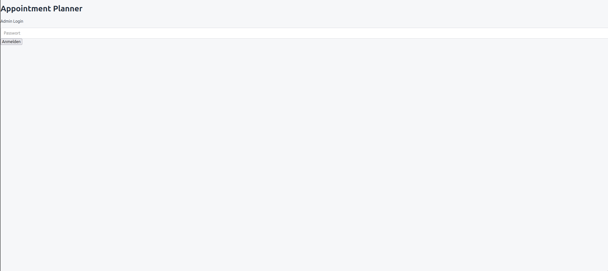
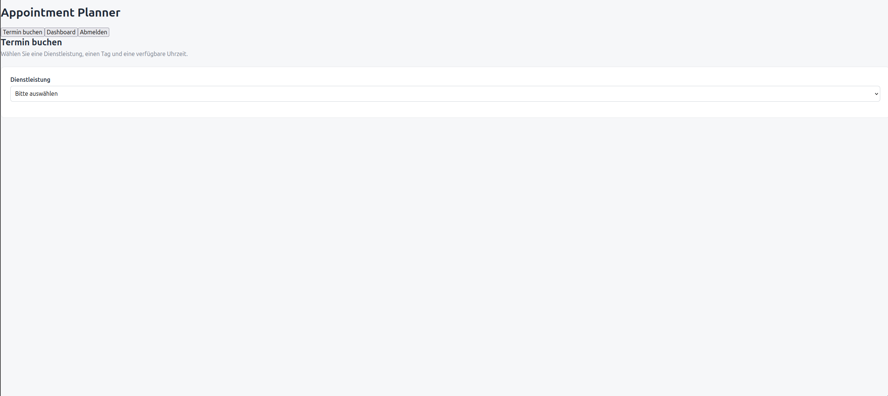
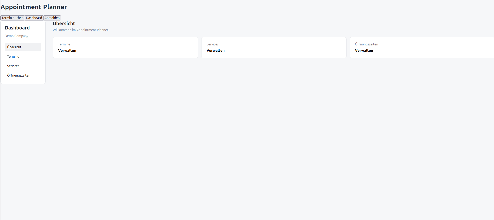
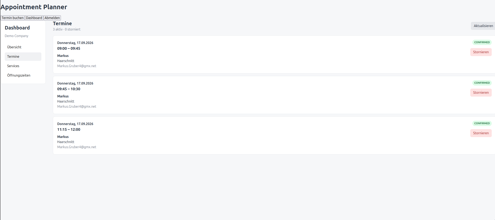

# Appointment Planner

A containerized appointment booking application built as an AWS portfolio project.

The application provides a complete appointment workflow for small businesses: customers can book available appointments, while operators can manage services, opening hours and appointments through a dashboard.

The current version is a working MVP deployed on AWS EC2.

---

## Screenshots

> Screenshots will be added here.

### Login



### Appointment Booking



### Dashboard



### Appointments



---

## Features

### Customer Booking

Customers can:

* Select a service
* Select a date
* View available time slots
* Enter their name and email address
* Confirm an appointment

The booking system checks:

* Service availability
* Opening hours
* Existing appointments
* Appointment overlaps
* Service duration
* Company timezone

### Operator Dashboard

The dashboard allows operators to manage:

* Appointments
* Services
* Opening hours
* Appointment cancellations

### Email Notifications

After a successful booking, the application sends:

* Confirmation email to the customer
* Notification email to the company

Email delivery is handled through AWS SES.

The emails contain dynamically generated appointment information such as:

* Customer
* Service
* Date
* Time
* Company

---

## Architecture

The current application runs as three Docker containers:

```text
                         Browser
                            │
                            ▼
                   ┌─────────────────┐
                   │ React Frontend  │
                   │     Docker      │
                   └────────┬────────┘
                            │ REST API
                            ▼
                   ┌─────────────────┐
                   │ Fastify Backend │
                   │     Docker      │
                   └───────┬───┬─────┘
                           │   │
                ┌──────────┘   └─────────────┐
                ▼                            ▼
       ┌─────────────────┐          ┌─────────────────┐
       │   PostgreSQL    │          │     AWS SES     │
       │     Docker      │          │     Email       │
       └─────────────────┘          └─────────────────┘
```

### AWS Deployment

```text
                         AWS
                          │
                          ▼
                    ┌────────────┐
                    │    EC2     │
                    │            │
                    │  Docker    │
                    │  Compose   │
                    └─────┬──────┘
                          │
              ┌───────────┼───────────┐
              │           │           │
              ▼           ▼           ▼
          Frontend       API      PostgreSQL
                          │
                          ▼
                       AWS SES
```

The EC2 instance uses an IAM role to access AWS services. AWS access keys are not stored inside the application.

---

## Technology Stack

### Frontend

* React
* TypeScript
* Vite
* CSS

### Backend

* Node.js
* TypeScript
* Fastify
* Prisma

### Database

* PostgreSQL 16

### AWS

* Amazon EC2
* AWS IAM
* Amazon SES

### Infrastructure

* Docker
* Docker Compose

### Development

* Git
* GitHub
* Linux
* npm

---

## Project Structure

```text
appointment-planner/
│
├── backend/
│   ├── prisma/
│   │   ├── migrations/
│   │   ├── schema.prisma
│   │   └── seed.ts
│   │
│   ├── src/
│   │   ├── lib/
│   │   ├── routes/
│   │   └── server.ts
│   │
│   ├── Dockerfile
│   └── package.json
│
├── frontend/
│   ├── src/
│   │   ├── components/
│   │   ├── pages/
│   │   ├── lib/
│   │   └── App.tsx
│   │
│   ├── Dockerfile
│   └── package.json
│
├── docs/
│   └── screenshots/
│
├── docker-compose.yml
├── .gitignore
└── README.md
```

---

## Database Model

The main domain entities are:

```text
Company
   │
   ├── Services
   │
   ├── Availability
   │
   └── Appointments
          │
          └── Service
```

Appointments are stored in PostgreSQL using Prisma ORM.

The application stores appointment timestamps in a timezone-aware manner and converts them for the company's configured timezone.

---

## Local Development

Clone the repository:

```bash
git clone https://github.com/CodeByMaxx/appointment-planner.git
cd appointment-planner
```

Start the complete application:

```bash
docker compose up -d --build
```

The application provides:

```text
Frontend    http://localhost
API         http://localhost:3001
PostgreSQL  localhost:5432
```

Check the API:

```bash
curl http://localhost:3001/health
```

Expected response:

```json
{
  "status": "ok",
  "service": "appointment-planner-api"
}
```

---

## Database Migrations

Prisma is used for database schema management.

Apply migrations with:

```bash
docker compose exec api npx prisma migrate deploy
```

---

## Current MVP Status

The following functionality is currently implemented:

* [x] React frontend
* [x] Fastify REST API
* [x] PostgreSQL database
* [x] Prisma ORM
* [x] Service management
* [x] Opening hours management
* [x] Availability calculation
* [x] Timezone-aware slot generation
* [x] Appointment creation
* [x] Appointment cancellation
* [x] Operator dashboard
* [x] Administrator login
* [x] AWS EC2 deployment
* [x] Docker Compose deployment
* [x] AWS SES integration
* [x] Customer confirmation emails
* [x] Company notification emails

---

## Security

The current version is an MVP and contains intentionally simplified authentication and infrastructure configuration.

The following areas are planned for hardening:

* Server-side authentication
* HTTPS
* Restricted security groups
* Removal of publicly exposed database ports
* Secure configuration management
* Improved secret management
* Application monitoring

AWS credentials are not stored in the application. The EC2 instance uses an IAM role for AWS service access.

---

## Deployment Model

The application is designed around isolated customer environments.

The intended deployment model is:

```text
Customer A
    │
    ▼
AWS Environment A
    │
    └── Appointment Planner

Customer B
    │
    ▼
AWS Environment B
    │
    └── Appointment Planner
```

Each customer can therefore have an independently deployed application environment and database.

The current implementation uses EC2 and Docker Compose as a simple deployment model.

---

## Roadmap

### Infrastructure

* [ ] Remove dependency on fixed EC2 IP addresses
* [ ] Centralize deployment configuration
* [ ] Make deployments reproducible
* [ ] Add HTTPS and custom domain
* [ ] Improve AWS security configuration
* [ ] Move PostgreSQL to Amazon RDS
* [ ] Evaluate ECS/Fargate
* [ ] Add monitoring and logging

### Application

* [ ] Production-ready authentication
* [ ] Appointment rescheduling
* [ ] Improved validation and error handling
* [ ] Automated tests
* [ ] Improved dashboard
* [ ] Better administration features

### Service Architecture

The long-term goal is to evolve the application into independently deployable services.

Potential future services include:

```text
                  Appointment Service
                          │
             ┌────────────┼────────────┐
             ▼            ▼            ▼
       Notification    Billing       CRM
         Service       Service      Service
             │
             ▼
       Invoice Service
             │
             ▼
       Accounting Service
```

Additional services such as reporting and an AI-based assistant may be added later.

The services should communicate through clearly defined APIs and, where appropriate, asynchronous messaging.

---

## Portfolio Goals

This project demonstrates practical experience with:

* AWS infrastructure
* Docker containerization
* REST API development
* React and TypeScript
* PostgreSQL
* Prisma ORM
* IAM roles
* AWS SES
* Cloud deployment
* Database design
* Timezone-aware business logic
* Service-oriented architecture

The project is intentionally being developed from a working MVP toward a more production-oriented cloud architecture.

---

## Repository

This repository is used as the public portfolio and documentation repository.

The application source code is maintained separately during development.

**Status:** Working MVP deployed on AWS

